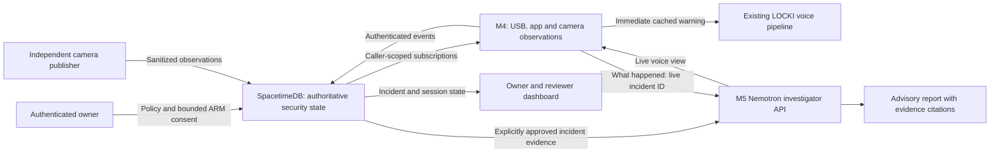

# LOCKI AIRLOCK

LOCKI AIRLOCK guards a workstation while its owner is away. The Mac watches USB devices, app launches and, when armed, the desk camera. A
SpacetimeDB module decides incidents, sessions and lock requests. LOCKI speaks a warning at once, changes its delivery with the security mode,
and answers questions from the recorded evidence. An NVIDIA Nemotron model investigates incidents through approved, read-only tools.

Built for HackUTD 2026 by Dhruv Jain, Siddartha Kodithyala, Areeb Hirani and Mustafa Hassan.

> **Status: integration snapshot, not a finished release.** Mustafa's service, its M4 client and Areeb's Jetson runtime are present in source.
> The pinned `afd008e` handoff is being reconciled with the reviewed client/runtime safeguards. Actual M4/M5 activation, scoped evidence receipts and physical acceptance remain separate gates. See [Remaining integration work](#remaining-integration-work).

**Start here:** [Project map and ownership](docs/airlock/PROJECT_MAP.md) · [Original PRD](docs/airlock/PRD.md) ·
[Acceptance checklist](docs/airlock/RELEASE_ACCEPTANCE.md) · [Wire contracts](docs/airlock/CONTRACTS.md) ·
[M4 voice handoff](docs/airlock/M4_VOICE_ARM.md) · [M5 investigator contract](services/nemotron-investigator/INTEGRATION.md).

## How it works



- **The module decides.** Arming, incidents, severity and lock requests belong to SpacetimeDB. The Mac observes local activity, issues immediate warnings, and reads the views
  scoped to its own identity (`my_sessions`, `my_incidents`, `my_device_events`, `my_lock_requests`).
- **The local warning never waits.** A USB warning plays from the voice cache before the server answers, so it waits for neither the module
  nor Nemotron.
- **Contracts:** [spacetime/CONTRACT.md](spacetime/CONTRACT.md) (reducers, rows, views) and [docs/airlock/CONTRACTS.md](docs/airlock/CONTRACTS.md)
  (Mac and camera messages, metadata keys, health values, security modes).

**What an incident means.** A person in the desk zone is a soft observation. An unknown USB while armed opens an incident even without a
camera; matching physical evidence within the same session's 10-second window raises server severity. An unapproved app requires review,
not a declaration of compromise. The present camera adapter does not prove whether someone walked past, stood nearby or interacted with
the computer. Those differences must be measured with [consenting volunteer trials](docs/airlock/ACCURACY_TRIALS.md).

**Current source wiring.** For “what happened?” about an authoritative live `incident:<32 lowercase hex>`, the existing runtime selects
`NemotronService` when its M4 API requester key is configured. That client sends `evidence_mode: "live"` to Mustafa's authenticated API and
polls its voice view. Local cases retain `AirlockAgent` through the existing Ollama/fallback path. This is one route selection in the existing
voice runtime, not a second backend. Credential/origin checks, report binding and stale-result handling are under independent review.
The source path is present; current M4/M5 activation, the actual evidence grant and model/voice receipts remain unverified. Alerts never wait on this enrichment.
The incoming handoff also adds a read-only investigation-record route for the recorded-turn panel, with grounded facts, evidence IDs, tools and latency. Its reconciliation must preserve current authorization, exact report binding and per-turn result isolation; earlier full-suite results do not certify this addition.

**Independent edge source.** Areeb's runtime is now in `edge/jetson/locki_edge/`, with its [deployment runbook](docs/airlock/edge/DEPLOY.md).
It supports explicit OpenCV DNN MobileNet-SSD person detection for JetPack 6, detectNet and motion-only alternatives, a durable metadata outbox,
server sequence synchronization and bounded presence reassertion. Motion remains labelled as motion; person presence does not prove interaction or intent.
Sid's earlier `airlock_camera.py` adapter remains available. Choose one publisher for each device and camera; their sequence stores are separate.

## Repository layout

| Path | What | Owner |
|---|---|---|
| `backend/app/security/` | Mac watchers, security service, SpacetimeDB adapter, security modes, demo mode, lock adapter (dry run) | Dhruv |
| `backend/app/vision/airlock/` | Desk camera: person tracking and interaction zones; legacy face code is disabled by default | Dhruv |
| `backend/app/voice/` | Speech queue, Kokoro / Fish Audio, Bluetooth tail fix, per-mode delivery (`delivery.py`), personality lines | Dhruv |
| `backend/app/intelligence/` | Conversation, local investigator (`airlock_agent.py`), M5 API client (`nemotron_service.py`), Sid's transport (`nemotron_transport.py`) | Dhruv, Sid |
| `services/nemotron-investigator/` | Authenticated Nemotron API, incident-scoped read tools, evidence grounding and benchmark artifacts | Mustafa |
| `backend/app/` (other) | FastAPI runtime kept from LOCKED IN: API, bus, telemetry, voice input, and the robot and focus modules it still imports | Dhruv |
| `frontend/src/airlock/`, `frontend/src/airlock-bindings/` | Security dashboard and generated SpacetimeDB bindings | Sid |
| `frontend/src/demo/`, `frontend/src/components/` | Mac backend view and the live demo | Dhruv |
| `spacetime/` | SpacetimeDB TypeScript module: enrollment, roles, sessions, correlation, approvals, lock requests, views | Sid |
| `edge/jetson/` | Areeb's `locki_edge` runtime, contract fixtures and tools; Sid's earlier camera adapter retained separately | Areeb, Sid |
| `scripts/` | TypeScript bridges, publishers, lock adapter, Nemotron tool adapter, Mac setup | Sid, Dhruv |
| `examples/` | Sandbox case for the protected-tool gate, Code Quest template | Dhruv |
| `docs/airlock/` | Contracts, demo, vision, voice, NVIDIA, handoff, evidence | all |
| `docs/legacy/` | LOCKED IN robot-era docs that the retained code still cites | — |

Integration choices are recorded in [docs/INTEGRATION_DECISIONS.md](docs/INTEGRATION_DECISIONS.md). The sources of this snapshot are in
[docs/MIGRATION.md](docs/MIGRATION.md).

## Hardware and roles

| Machine | Role |
|---|---|
| **M4 MacBook (Dhruv)** | The guarded workstation: backend on `127.0.0.1:8077`, USB and app watchers, desk webcam, speaker (tested with a JLab GO Party over Bluetooth), dashboard dev server on `:5174` |
| **M5 MacBook Pro (Mustafa)** | Ollama with `nemotron-3.5-bolt:e4b`. The M4 reaches it over Tailscale through an SSH tunnel; Ollama itself listens on loopback only |
| **NVIDIA Jetson (Areeb)** | Second camera publishing `person_in_zone` / `camera_*` events as an enrolled `jetson` device |
| **SpacetimeDB maincloud** | Database `locki-w91bw` at `https://maincloud.spacetimedb.com` |

## Setup (M4)

The Mac runtime needs macOS on Apple silicon, Python 3.12 with [uv](https://docs.astral.sh/uv/), Node 24.22.1+ within Node 24, and SpacetimeDB CLI 2.14.1.
For a fresh checkout, install the locked software dependencies without downloading model weights:

```sh
git clone https://github.com/Dhruvjain35/locki-airlock.git ~/locki-airlock
cd ~/locki-airlock
uv sync --project backend --frozen --group dev --extra vision
npm ci --prefix frontend --no-fund
npm ci --prefix spacetime --no-fund
make preflight
```

`make setup` is the larger Mac/model setup; it installs all extras and downloads pinned models. Models and credentials stay out of Git.
If the M4 backend is already running, use the [controlled integration handoff](docs/airlock/M4_VOICE_ARM.md) rather than starting a second copy.

**SpacetimeDB identity.** Preserve the existing Mac, camera and owner credentials. On a genuinely new Mac, `backend/scripts/airlock.py
spacetime-setup` creates its separate device identity; the owner must then enroll the verified identity as `mac`. Camera enrollment uses the
verified configured publisher identity and the deployed `jetson` role. Never substitute a Mac/admin token for an owner or investigator.
See [contracts and enrollment boundaries](docs/airlock/CONTRACTS.md).

**Two different M5 connections.** Keep these contracts separate:

| Connection | M4 endpoint | Purpose |
|---|---|---|
| Raw Ollama tunnel | `127.0.0.1:11435` → M5 `127.0.0.1:11434` | Retained in-process investigator for local cases; optional conversation uses separate settings |
| Investigator API tunnel | `127.0.0.1:18787` → M5 `127.0.0.1:8787` | New M4 source client for authoritative live incident questions; current host activation remains unverified |

The existing raw Ollama tunnel is:

```sh
ssh -N -L 11435:127.0.0.1:11434 <user>@<m5-tailscale-name>
```

Then set `LOCKEDIN_AIRLOCK_OLLAMA_URL=http://127.0.0.1:11435`. Use the names from `tailscale status`, never a fixed address in committed config.
That setting configures investigation. Conversation uses its own `LOCKEDIN_LOCAL_LLM_BACKEND=ollama` and `LOCKEDIN_OLLAMA_URL` settings.
The API client uses `LOCKI_INVESTIGATOR_URL` (default `http://127.0.0.1:18787`) and `LOCKI_INVESTIGATOR_KEY_FILE`
(default `~/.locki/investigator.key`). That M4 file holds the API requester key. It is distinct from the M5's `NI_STDB_TOKEN_FILE`, which
holds the evidence-only SpacetimeDB investigator credential, and from the owner's grant credential. Follow the [v0.3 handoff](services/nemotron-investigator/INTEGRATION.md)
and coordinate adoption of the reviewed client/runtime before a live trial; source configuration is not proof of a working tunnel or grant.

**Voice.** `LOCKEDIN_SECURITY_VOICE=am_onyx` speaks every security line in local Kokoro, offline. Pick the output device in the dashboard's
voice settings. Fish Audio is optional: it needs `FISH_AUDIO_API_KEY` in `.env`, and it's skipped while the one security voice is on.

**Camera.** `LOCKEDIN_AIRLOCK_VISION=true`, or `make airlock-mac VISION=1`, turns the desk camera on only while armed or in a demo. Draw the
zones once with `cd backend && .venv/bin/python scripts/airlock_zones.py`: `2` marks the keyboard, `4` the USB ports, `s` saves.

## Controlled demo procedure

Before you start, check that nothing else is using the camera or the USB monitor, and run only one backend.

```sh
# terminal 1: coordinated M5 tunnels (18787 API for live incident questions; 11435 raw Ollama for retained local/conversation paths)
# terminal 2: inspect environment before starting the Mac runtime
cd ~/locki-airlock
make preflight
# terminal 2: the Mac backend, with security on, the camera on while armed, and locks as dry runs
make airlock-mac VISION=1 SPACETIME_URL=https://maincloud.spacetimedb.com SPACETIME_DB=locki-w91bw OLLAMA=http://127.0.0.1:11435
# terminal 3: the dashboard
cd ~/locki-airlock/frontend && npm run dev
#   Sid's security dashboard:   http://127.0.0.1:5174/
#   Mac view and live demo:     http://127.0.0.1:5174/#demo
```

Then follow "Each demo" in [docs/airlock/DEMO.md](docs/airlock/DEMO.md):

1. Start the demo and review camera and monitoring readiness. Face enrollment is not required.
2. Arm through the authenticated owner dashboard, or grant the next live voice ARM and verify the committed armed state; then leave the desk.
3. Bring in a volunteer to sit down, type, and plug in a harmless USB stick.
4. Ask "LOCKI, what happened?"
5. Come back and review the observations. The workstation stays armed until authenticated disarm.
6. Disarm on the dashboard.

`make airlock-check` is a separate active integration check: it opens/closes Calculator, creates a temporary local session and renders
Kokoro audio without playing it. It is not an inspection-only preflight. Coordinate it with the operator and existing watcher process.

**Security desk on a second Mac (Areeb's).** On that Mac, after cloning: `npm ci --prefix frontend && make desk`, then open
http://127.0.0.1:5180/?client=desk&view=desk. It is the dashboard as static files that talk only to SpacetimeDB, never to the M4's backend, and it
listens on 127.0.0.1 only. The desk creates its own identity. The owner enrolls it with **Enroll identity → Grant human reviewer access**, with
approval unchecked. It can view this workstation's incidents, evidence and investigation, and acknowledge them. Never make the M4's Vite server
listen beyond 127.0.0.1: its `/api` proxy reaches the backend's routes.

**Arming and disarming.** The authenticated owner may arm directly or choose **Authorize next voice ARM** on the dashboard. The owner reviews
one enrolled Mac, its fresh baseline/app, approved apps and duration, then keeps the console connected. The Mac can consume that one-use
permission within 30 seconds when told “LOCKI, watch my setup.” It confirms only after fresh database readback. Disarming requires the owner.
See [existing M4 integration](docs/airlock/M4_VOICE_ARM.md). If only the M4 CLI is authenticated, the optional
[local owner consent window](docs/airlock/OWNER_CONSENT.md) keeps that credential on the M4; no token enters voice and no second voice service is needed.


## Offline and degraded behaviour

| If this is missing | What happens |
|---|---|
| SpacetimeDB unreachable | Local warnings and modes still run. Events queue and retry when the server is unreachable or returns 5xx; a reducer error is final and recorded |
| Nemotron / M5 unreachable | The investigation falls back to a local model, labelled "not Nemotron", or reports it's unavailable. Warnings still play |
| Mustafa API or evidence grant unavailable | Its live investigation fails or is withheld; no silent substitution with fixture evidence. It does not delay local warnings |
| Camera unavailable | The camera reports `camera_offline` and health `degraded` or `unavailable`. USB and app monitoring continue |
| No internet | `LOCKEDIN_OFFLINE=true` (set by `make airlock-mac`): Fish Audio and model hubs are never contacted, and Kokoro speaks |

## Safety limits

- **Screen locks are dry runs** unless the owner starts the backend with `LOCK=real`, after agreeing to a test with someone there to unlock.
- **Face identification is disabled by default** (`LOCKEDIN_AIRLOCK_FACE_IDENTIFICATION=false`). The primary camera uses person and zone observations, preserving the PRD's no-biometric-recognition scope.
- **Voice never authorizes.** Arming and disarming need the owner's authenticated action.
- **Recordings are conversation input.** Uploaded speech cannot ARM or DISARM, even when a live voice grant exists.
- **Investigator means read-only.** It receives only approved incident/event/frozen-baseline projections. `grant_reviewer(false)` still grants writes and is not an investigator role.
- **Fixtures stay labelled.** Demo fixtures and simulated events are marked as such, and the live demo refuses them.
- **Existing face templates stay unused by default.** Legacy face code is retained outside P0, behind a separate optional setting. Camera events carry no images,
  identities or embeddings, and USB serials leave the Mac only as salted hashes.
- **One consumer per device.** Locks on the camera and the USB monitor stop a second watcher. Sid's standalone `app.security.voice_service`
  is a second voice path, and `mac_observer.py` is a second USB poller. Don't run them beside `make airlock-mac`
  ([integration decisions](docs/INTEGRATION_DECISIONS.md)).

## Evidence and acceptance

The [release acceptance checklist](docs/airlock/RELEASE_ACCEPTANCE.md) maps all ten P0 requirements and every named PRD criterion to
its evidence and remaining gate. The [machine-readable manifest](docs/airlock/evidence/release-acceptance.json) records source/log hashes.
Historical camera, audio and model timings in the runbooks are attributed team measurements; they are not fresh physical acceptance results.

## Verified so far

| Check | Status |
|---|---|
| Backend software | Reviewed M4 client checkpoint: 1,852 passed; 20 skipped. This predates the incoming `afd008e` edge/recorded-investigation merge |
| Investigator service software | Source-scoped baseline: 387 passed; one skipped; three real-model tests deliberately excluded |
| Frontend | Earlier checkpoint: 54 tests, typecheck and production build; new recorded-investigation and separate owner-recovery delivery require their own checks |
| GitHub Actions | Workflow published; latest inspected run failed at startup before any jobs. Cause unknown; local checks do not imply CI success |
| Real M4 hardware | Team reports: USB (IOKit), app launches, webcam person detection, audible warnings over Bluetooth. The new face-disabled default has not been activated or verified on the running M4 |
| Live SpacetimeDB | Current owner-armed session and committed non-simulated Jetson person rows independently read back; Mac USB/audio timings remain team reports. Separate M4 camera enrollment is still an owner action |
| Real Nemotron inference | Team reports one investigation from the M4 through the M5 (above); current host artifacts and scoped Mustafa access remain unverified |
| Real Jetson hardware | Team reports operation; stored non-simulated person events verified. Hardware inventory, soak, unplug recovery and accuracy trials remain open |
| Real screen lock | **Not run** (dry run only, by design) |

## Remaining integration work

- **Edge host acceptance.** The `e1c1a7b` snapshot of Areeb's `feature/airlock-edge` and its follow-ups are included in the pinned `afd008e` handoff.
  Source presence closes the missing-edge-code gate. Actual inventory, capture/receipt provenance, soak/unplug recovery and 20–40 consented activity/false-alert trials remain open. The new [edge runbook](docs/airlock/edge/README.md) and Sid's [retained adapter runbook](edge/jetson/README.md) describe separate publishers, not two processes to run together.
- **Mustafa's live investigator host.** The source and v0.3 contract are included under `services/nemotron-investigator/`.
  The M4 runtime client is included too; its previous reviewed checkpoint passed 1,852 backend tests, and the incoming record/client changes are being reconciled with those safeguards. Activation of the reviewed changes
  on both hosts, the actual owner-local evidence grant and an investigation using his existing identity
  still require host receipts. Model weights, credentials and private live investigation records never belong in git.

To add a missing lane, follow "Adding your lane" in [CONTRIBUTING.md](CONTRIBUTING.md). It copies a snapshot of your files without the old history.

## Tests

Run from the repository root with Python 3.12, uv and Node.js 24. Install the locked
software test dependencies first:

```sh
uv sync --project backend --frozen --group dev --extra vision
npm ci --prefix frontend --no-fund
npm ci --prefix spacetime --no-fund
```

The vision extra supplies the locked OpenCV package used to decode synthetic
frames and verify markers in the tests. Model weights are separate and are not
downloaded by this setup; tests requiring them skip when the files are absent.

```sh
PYTHONPATH=backend backend/.venv/bin/python -m pytest -q backend/tests               # full backend software suite
PYTHONPATH=services/nemotron-investigator/src backend/.venv/bin/python -m pytest -q -c services/nemotron-investigator/pyproject.toml services/nemotron-investigator/tests
npm run check --prefix spacetime && npm test --prefix spacetime                     # module types and transactional tests
npm test --prefix frontend && npm run build --prefix frontend                       # dashboard
node frontend/node_modules/tsx/dist/cli.mjs --test scripts/*.test.ts scripts/tests/*.test.ts   # bridges and adapters
node --test scripts/airlock_owner_consent_http.test.mjs scripts/airlock_investigator_verify.test.mjs
PYTHONPATH=backend backend/.venv/bin/python -m unittest discover -s edge/jetson/tests            # Jetson adapter
```

The [CI workflow](.github/workflows/airlock.yml) defines software checks without real model inference or OS actions. Its current startup
failure remains open. Physical camera, USB, audio, model, Relay and screen-lock checks require separate honest acceptance artifacts.
