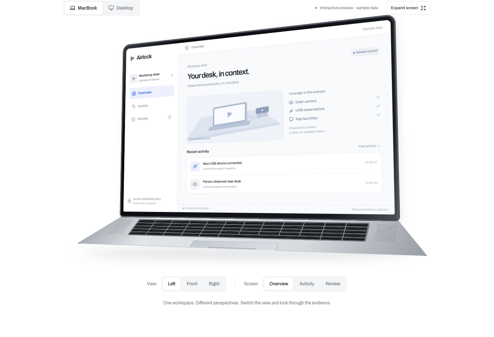
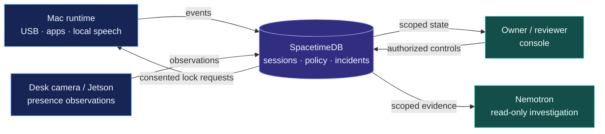

# LOCKI AIRLOCK

**Workspace security for shared engineering desks.**

[](https://github.com/Dhruvjain35/locki-airlock/actions/workflows/airlock.yml)
[](backend/pyproject.toml)
[](frontend/package.json)
[](spacetime/package.json)

[Preview](#product-preview) · [Workflow](#workflow) · [Architecture](#architecture) · [Quick start](#quick-start) · [Development](#development)

Airlock combines Mac USB changes, visible app launches and desk-camera observations in a shared incident timeline. Owners configure the response; authorized reviewers inspect the evidence. Local warnings run independently of the investigation model, and automatic screen locking requires owner policy and local consent.

**Integration prototype.** Mac, dashboard, database, Jetson and investigator source are present. Physical accuracy, deployed configuration, actual lock/unlock behavior and model integration remain subject to [release acceptance](docs/airlock/RELEASE_ACCEPTANCE.md).

[](#product-preview)

## Product preview

Explore the MacBook and desktop views, rotate the device, switch between Overview,
Activity and Review, or change the background. **Expand screen** opens a readable
view on smaller displays. The preview uses sample data and runs independently of
the live console.

```sh
npm ci --prefix frontend
npm run dev --prefix frontend
```

Open the printed URL with `?product=landing`. The normal URL still opens the console;
`?product=legacy` and `#demo` retain the Mac diagnostic views.

## Workflow

1. **Arm.** The authenticated owner captures a fresh device baseline and freezes the session policy. Speech alone grants no permission.
2. **Leave.** Lock the Mac normally. Airlock monitors selected events and adds camera context; compatibility with locked engineering workloads remains an acceptance requirement.
3. **Review.** Open the shared timeline from an authorized console. Inspect observations, acknowledge the incident and request an evidence-based explanation from Nemotron.
4. **Return.** Unlock through macOS and disarm through owner controls. Resolving an incident does not grant future trust to a device or person.

A friend approaching the desk must not become an accusation. Presence alone does not request an automatic lock, but the local presence-warning path still needs work to meet the intended quiet behavior. See [product behavior](docs/airlock/PRODUCT.md) and the [demo walkthrough](docs/airlock/DEMO.md#product-walkthrough).

## Architecture



SpacetimeDB owns incident rules and action permissions. Nemotron uses scoped, read-only evidence tools. A separate managed-workflow gate authorizes selected protected callbacks before execution; it does not control arbitrary applications or agents. See the [database contract](spacetime/CONTRACT.md) and [device contracts](docs/airlock/CONTRACTS.md).

## Quick start

For a local database and dashboard rehearsal, install **Node 24.22.1+ in the Node 24 line** and **SpacetimeDB CLI 2.14.1**, then run from this repository:

```sh
npm ci --prefix spacetime
npm ci --prefix frontend
make airlock
```

Open the URL printed by the launcher. This path uses labelled synthetic observations; it starts no camera, microphone, model, robot or real screen-lock adapter.

- [Local integration](docs/airlock/README.md): identities, two-console review and persistence.
- [Mac and hardware setup](docs/airlock/SETUP.md): cameras, voice, enrollment and model connections.
- [Investigator service](services/nemotron-investigator/README.md): evidence tools and service integration.

## Boundaries

- **Native locking is the access baseline.** Real Airlock locks are opt-in and default to dry run. A request is not confirmed OS lock; screen locking is not shutdown.
- **Observation is limited.** Already-open apps can be misused without a new launch event. Airlock does not establish malware, theft, copied data or who caused a temporally correlated event.
- **Face identification defaults off.** The Jetson presence adapter does not establish identity or permission. Robot motion is outside this product's operating scope.

[Workspace scenarios](docs/airlock/SCENARIOS.md) and the [test plan](docs/airlock/TEST_PLAN.md) cover ordinary collaboration, failures and recovery. These are planned acceptance cases, not passing results.

## Development

| Path | Responsibility |
|---|---|
| [backend/app](backend/app/) | Mac monitoring, vision, voice and conversation |
| [frontend](frontend/) | Owner/reviewer console and Mac demo |
| [spacetime](spacetime/) | Sessions, policy, incidents and permissions |
| [edge/jetson](edge/jetson/) | Edge runtime and standalone camera adapter |
| [services/nemotron-investigator](services/nemotron-investigator/) | Investigation service and evidence tools |
| [scripts](scripts/) · [examples](examples/) | Setup, adapters, verification and managed-workflow examples |

Use the [software checks](docs/airlock/SETUP.md#software-checks) and [physical accuracy protocol](docs/airlock/ACCURACY_TRIALS.md). Follow [CONTRIBUTING.md](CONTRIBUTING.md) for branches, review and private-data exclusions.

Built for **HackUTD 2026** by **Dhruv Jain, Siddartha Kodithyala, Areeb Hirani and Mustafa Hassan**. [SOURCE_NOTICE.md](SOURCE_NOTICE.md) records authorship, upstream provenance and licensing; [migration notes](docs/MIGRATION.md) preserve the integration history.
