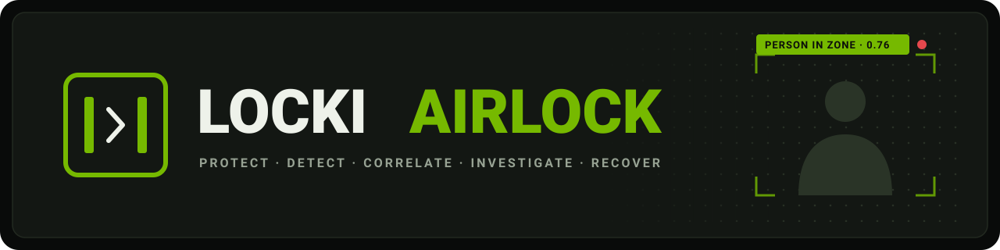
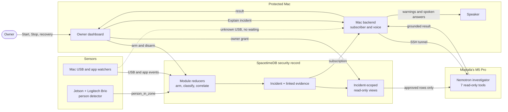
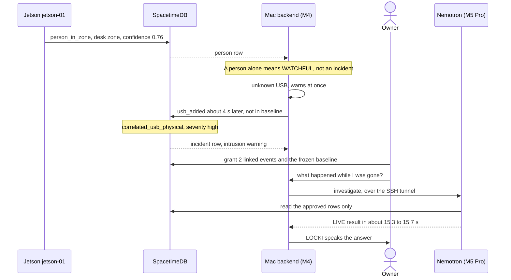

<p align="center">
  
</p>

<h1 align="center">LOCKI AIRLOCK</h1>

<p align="center"><strong>Watches your desk while you're away. Explains what happened when you're back.</strong></p>

<p align="center">
  
  
  
  
  
  
</p>

LOCKI AIRLOCK guards a computer while its owner is away. An NVIDIA Jetson camera watches the desk, the Mac watches its USB ports and app launches, and a SpacetimeDB module decides with fixed rules when the two add up to an incident. Ask what happened, and NVIDIA Nemotron reviews only the evidence you approved while LOCKI, the Mac's voice, speaks the answer.

> **Screenshots** will follow the dashboard redesign; see the [planned shots](docs/assets/README.md).

## The problem

Leave a laptop at a desk and the next person to sit down has a few unobserved seconds, enough to plug in a USB device. A camera might see them and the Mac might log the device, but neither fact alone tells the owner what happened. AIRLOCK joins the two with fixed rules and explains the evidence on request.

## How it works

| Step | What happens |
|---|---|
| **Protect** | **Start protection** freezes the Mac's USB devices as the session baseline. It refuses while auto-lock is on. |
| **Detect** | The Jetson publishes `person_in_zone`; the Mac publishes USB and app events. Each has its own enrolled identity. |
| **Correlate** | An unknown USB device or unapproved app opens an incident; a person within 10 s of the USB event makes it high. A person alone gets only a spoken warning. |
| **Investigate** | **Explain incident** asks the owner to approve that incident's evidence. Nemotron reads only those rows; LOCKI speaks the result. |
| **Recover** | **Stop protection** disarms and revokes the investigator's access. Incidents stay in **History**. |

New to SpacetimeDB? It's a database that runs app logic inside itself: clients call permission-checked functions (reducers) that write rows in one transaction, and subscribe only to rows they may see.



## A real security event

On 8 November 2026 the M4 ran an owner-armed live session: not simulated, one hour, auto-lock off, screen lock in dry run. A person at the desk and an unknown USB device, four seconds apart, became one high-severity incident: *"Unknown USB device detected within 10 seconds of a person in the desk zone."* The Mac spoke an unknown-USB warning and an intrusion warning; once the owner approved the evidence, Nemotron explained it.



Nemotron (`nemotron-3.5-bolt:e4b`) returned `completed_with_warnings`. The official severity, high, stands; Nemotron's own view was medium risk, low confidence. Four grounded findings: the person observation, the USB device added, its key missing from the baseline, and no app launches in the window. It asked for human review and reported the armed-session record as outside its approved scope. Latency: Jetson to SpacetimeDB about 306–325 ms (two device clocks), SpacetimeDB to the M4 about 69 ms, presence warning starts 0.5–0.7 s after the observation.

- **Observation:** a person in the desk zone; a USB device the session had not seen.
- **Suspicion:** both within 10 s in one armed session, hence a high-severity incident.
- **Confirmed compromise:** not established. Nothing showed who the person was, that they plugged it in, or that it was harmful.

## Technology

| Component | What it does | Why it matters |
|---|---|---|
| NVIDIA Jetson + Logitech Brio | `locki_edge` detects people, publishes presence and camera health; frames never leave it | Physical evidence from a separate device |
| macOS IOKit, NSWorkspace | USB arrivals and app launches; serials leave only as salted hashes | The digital half, from the OS |
| SpacetimeDB module | Sessions, baselines, correlation, incidents, evidence grants, scoped views | One authority; no model changes severity |
| NVIDIA Nemotron | Picks among 7 read-only tools for one granted incident; code keeps only grounded findings | Checkable, advisory explanations |
| FastAPI, local Kokoro voice | Deterministic modes and priority warnings | Warnings never wait for a network or model |
| React + TypeScript | Protection, Investigation, History; Start, Explain, Stop | Consent per incident |

- **Either order.** A person who appears after the USB device still upgrades the incident; the Jetson re-reports presence every 5 s.
- **Strict ingest.** Events must come from the enrolled device, fall in the armed session, be under 120 s old and arrive in order.
- **Least privilege.** The investigator reads three incident-scoped views and refuses to run if its identity holds any membership.
- **Grounded output.** A finding survives only if every ID it cites came from a tool call.

## Quickstart

The final target workstation is Areeb's M5 Pro, not yet verified; Dhruv's MacBook Air M4 is the tested fallback. The repository is private.

### 1. Software only

Python 3.12 with [uv](https://docs.astral.sh/uv/), Node 24.22.1+ on the Node 24 line.

```sh
git clone https://github.com/Dhruvjain35/locki-airlock.git ~/locki-airlock && cd ~/locki-airlock
uv sync --project backend --frozen --group dev --extra vision
npm ci --prefix frontend --no-fund && npm ci --prefix spacetime --no-fund
```

#### Tests

```sh
PYTHONPATH=backend backend/.venv/bin/python -m pytest -q backend/tests
npm test --prefix spacetime && npm test --prefix frontend
```

All CI suites: [software checks](docs/airlock/PROJECT_MAP.md#software-checks). Synthetic rehearsal on a local database: `make airlock`, then the [local prototype runbook](docs/airlock/README.md#local-prototype-runbook).

### 2. Physical hardware

```sh
make setup    # extras, pinned models (several GB), dashboard build
(cd backend && .venv/bin/python scripts/airlock.py spacetime-setup --workstation <workstation-id>)
LOCKEDIN_SPACETIME_REMOTE_CAMERAS=jetson-01 make airlock-mac
VITE_SPACETIMEDB_URI=https://maincloud.spacetimedb.com VITE_SPACETIMEDB_DATABASE=locki-w91bw npm run dev --prefix frontend
```

The owner enrolls the identity `spacetime-setup` prints (**Advanced controls → Enroll identity**). Run the last two in separate terminals; without the remote-camera setting, Jetson events never reach the Mac's voice. Locks stay dry runs. Jetson: [deploy runbook](docs/airlock/edge/DEPLOY.md).

### 3. Full system

Path 2 plus Mustafa's M5 Pro. Mustafa authorizes this Mac's own SSH key and issues an investigator key (`~/.locki/investigator.key`, mode 600).

```sh
LOCKI_M5_HOST=<m5-tailscale-name> LOCKI_M5_USER=<m5-account> bash scripts/airlock_launcher/install.sh
```

Double-click **LOCKI AIRLOCK** on the Desktop. It starts or reuses the backend and dashboard, keeps the SSH tunnel to the M5 up, reports **READY** or what is missing, and opens the owner dashboard. It never arms, grants evidence or enables a real lock. See the [runbook](scripts/airlock_launcher/RUNBOOK.md).

## Watch LOCKI in action

No video yet. The demo, under three minutes:

1. **Arm.** **Start protection**; review the baseline. Status: *Protected*.
2. **Quiet desk.** The owner leaves; baseline devices and approved apps raise nothing.
3. **Someone sits down.** LOCKI: "Hey, someone's at your workstation while it's armed." Not an incident.
4. **Unknown USB.** The Mac warns at once; with the person there, SpacetimeDB opens a high-severity incident.
5. **Explain.** Approve that incident's evidence; about 15 s later LOCKI speaks Nemotron's review.
6. **Stop and review.** **Stop protection** disarms and revokes access; **History** keeps the incident.

Emergency Containment, a visual response view, is in development on unmerged branches: not shipped, and not a screen lock or OS isolation.

## Verification and limitations

| Area | Status |
|---|---|
| Automated tests | Local guarded run on `a89cb7c`, no real keys: backend 1929 passed, 3 skipped · investigator 428 passed, 3 live-model tests deselected · edge/jetson 241 passed, 2 skipped · node scripts 50/50 · frontend tsc clean, vitest 163/163, build OK. Module tests not included. |
| GitHub Actions | **Not green.** Every recent run, including 42490844158 on `a89cb7c`, ended in `startup_failure` with no jobs. Cause not established. |
| Real observation | One live correlated incident, above (n = 1). |
| Real Nemotron | One LIVE investigation of it, spoken by LOCKI. The M5's code revision is unverified. |
| Physical acceptance | **Not complete:** Jetson inventory and soak, consented accuracy trials, two-client review, outage recovery, the move to Areeb's M5 Pro. |
| Screen lock | **Never executed.** Optional, owner-consented, dry run by default. |

Gate by gate: [release acceptance](docs/airlock/RELEASE_ACCEPTANCE.md) (predates the command center).

1. **Presence is not intent.** No one is identified; being near a device does not prove plugging it in.
2. **Unknown is not malicious.** A new device or app is a fact to review. Devices are never opened or scanned.
3. **Detection, not containment.** No network cutoff, process kill or USB blocking; it cannot stop a device or program that has already acted.
4. **The model is advisory.** It cannot act or lower a severity. Without the M5, warnings continue and LOCKI reads the local record.
5. **Infrastructure.** Needs Internet for SpacetimeDB, the Jetson and Mustafa's M5 on Tailscale. Offline, only Mac USB and app monitoring and the voice continue.
6. **Unmeasured.** No volunteer accuracy trials yet. The launcher enables face identification for the Mac's own camera (left off); the M4's setting is unverified.

## Team

- **Dhruv Jain** ([Dhruvjain35](https://github.com/Dhruvjain35)): owner and integrator; the Mac backend (watchers, modes, publisher, voice warnings, investigator client), command center and launcher.
- **Siddartha Kodithyala** ([s-k-28](https://github.com/s-k-28)): the SpacetimeDB module (sessions, correlation, voice-ARM delegation, evidence grants), the original dashboard and consent flows, bridge scripts, CI and acceptance docs.
- **Areeb Hirani** ([areebhirani-beep](https://github.com/areebhirani-beep)): the Jetson edge runtime `locki_edge` (capture, person detection, outbox, publisher), deploy tools and runbooks.
- **Mustafa Hassan** ([hasmus25](https://github.com/hasmus25)): the Nemotron investigator service and its M5 Pro host.

## Documentation

- **Architecture:** [project map](docs/airlock/PROJECT_MAP.md) · [module contract](spacetime/CONTRACT.md)
- **Setup:** [new Mac](scripts/airlock_launcher/NEW_MAC_SETUP.md) · [Jetson](docs/airlock/edge/DEPLOY.md) · [investigator](services/nemotron-investigator/README.md)
- **Demo:** [judge-day runbook](scripts/airlock_launcher/RUNBOOK.md) · [owner access](docs/airlock/OWNER_ACCESS.md)
- **Security and privacy:** [evidence grants](docs/airlock/INVESTIGATOR_INTEGRATION.md) · [screen lock](docs/airlock/LOCK_ADAPTER.md)
- **Tests and verification:** [release acceptance](docs/airlock/RELEASE_ACCEPTANCE.md) · [accuracy trials](docs/airlock/ACCURACY_TRIALS.md)
- **Contributing and handoff:** [CONTRIBUTING.md](CONTRIBUTING.md) · [every doc](docs/airlock/README.md)

LOCKI AIRLOCK extends LOCKED IN, built by Dhruv Jain, Siddartha Kodithyala, Areeb Hirani and Mustafa Hassan for HackUTD 2026 and preserved from `Dhruvjain35/locked-in` (branch `milestone-2`, commit `59d3208`). Its robot-era docs remain in [docs/legacy/](docs/legacy/) and at the top of `docs/`; AIRLOCK's requirements and no-motor, no-flash rules supersede their instructions. See [SOURCE_NOTICE.md](SOURCE_NOTICE.md). No license has been assigned to the team's source.

<p align="center"><strong>Step away. Come back. Ask LOCKI what happened.</strong></p>
